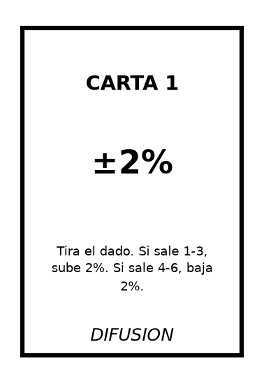
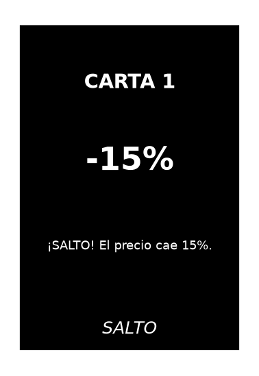

## Documentos para imprimir

| Documento | Uso |
|---|---|
| [Hoja de trabajo](docs/hoja_trabajo_gbm_o_merton.pdf) | 6 gráficos GBM/Merton sin parámetros + espacio de respuesta |
| [Clave de respuestas](docs/clave_respuestas.pdf) | Parámetros reales de cada gráfico (solo docente) |
| [Reglas del juego](docs/reglas_juego_mercado_que_salta.pdf) | "El Mercado que Salta": 20 cartas, roles y fórmula |
| [Taller: un salto en la vida real](docs/tarea_transferencia_salto_real.pdf) | Identificar un "salto" en finanzas o economía |
| [Agenda de clase](docs/plan_de_clase_merton.pdf) | Estructura de la clase, minuto a minuto |

## Cartas del juego

Imprime las 20 cartas, recorta y plastifica. 17 de difusión (fondo blanco) y 3 de salto (fondo negro).

::: {.merton-gallery}

{group="cartas" .lightbox}

{group="cartas" .lightbox}

:::

::: {.callout-tip}
## Truco de impresión
Haz clic en cualquier carta para verla a tamaño completo (lightbox). Usa la opción "Imprimir este documento" del navegador y papel tamaño carta o A4.
:::

Todas las cartas están en [`assets/cartas/`](https://github.com/JojjjT/merton-jump-diffusion-class/tree/main/assets/cartas) en el repositorio (17 difusión + 3 salto, PNG a 150 dpi).

## Gráficos del laboratorio

Los 6 gráficos de la hoja de trabajo (3 GBM, 3 Merton) están en [`assets/laboratorio_graficos/`](https://github.com/JojjjT/merton-jump-diffusion-class/tree/main/assets/laboratorio_graficos). Se regeneran con:

```bash
python scripts/generar_graficos_laboratorio.py
```

## Simulador Streamlit

Para proyectar el simulador completo en el aula:

```bash
pip install -r requirements.txt
streamlit run scripts/app_streamlit.py
```

Los estudiantes también pueden usar los [notebooks en Colab](index.qmd#recursos) y las [herramientas interactivas](herramientas.qmd) desde sus computadores.
